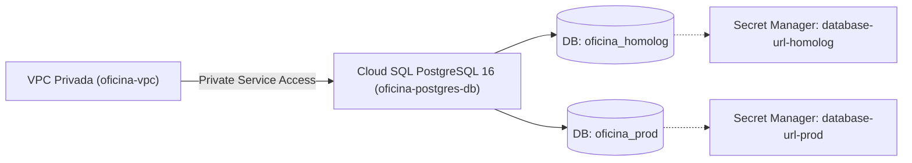

# Oficina Mecânica - Infraestrutura de Banco de Dados

[](https://sonarcloud.io/summary/new_code?id=jcontiero_oficina-database-infra)
[](https://sonarcloud.io/summary/new_code?id=jcontiero_oficina-database-infra)

## Propósito

Este repositório gerencia a instância compartilhada de banco de dados relacional gerenciado na GCP (**Cloud SQL for PostgreSQL 16**, instância `oficina-postgres-db`), com rede privada via VPC Peering (`oficina-vpc`), backups automáticos e publicação de strings de conexão isoladas por ambiente no **Google Secret Manager**.

## Propriedade do State Terraform e Isolamento de Dados

- **Backend GCS:** `gs://pos-fiap-2026-tf-state`
- **Prefixo:** `env/shared/database-infra`
- **Workspace canônico:** `main` (único dono da instância física `oficina-postgres-db` e dos segredos base).
- **Regra de proteção:** Como `modules/cloud-sql` e `modules/secrets` criam recursos compartilhados e ambos os bancos (`oficina_homolog` e `oficina_prod`), a branch `homolog` executa apenas `terraform plan` sobre o workspace `main` (nunca `apply` em um segundo workspace). O `terraform apply` ocorre exclusivamente após merge na `main` (GitHub Environment `production`).
- **Isolamento entre ambientes:**
  - Homologação utiliza o database `oficina_homolog` e o segredo `database-url-homolog`.
  - Produção utiliza o database `oficina_prod` e o segredo `database-url-prod`.
  - Na evolução da Fase 4 (P2/P7), os bancos dedicados por microsserviço (`oficina_os_{env}`, `oficina_billing_{env}`) e o Firestore (`oficina-execucao-{env}`) terão credenciais e states isolados por serviço e ambiente.

## Pré-requisitos e Variáveis

- Terraform `>= 1.9.0`
- VPC `oficina-vpc` e Private Service Access previamente provisionados pelo repositório `oficina-k8s-infra`.

| Variável | Default | Descrição |
| :--- | :--- | :--- |
| `project_id` | `fiap-project-514922` | ID do projeto GCP (Project Number `936717667971`) |
| `region` | `us-east1` | Região da instância Cloud SQL |
| `instance_name` | `oficina-postgres-db` | Nome da instância Cloud SQL |
| `db_version` | `POSTGRES_16` | Versão do PostgreSQL |
| `tier` | `db-f1-micro` | Machine tier da instância |
| `vpc_network_name` | `oficina-vpc` | Rede VPC para IP privado |

## Passos para Execução e Deploy

### Execução Local (a partir da pasta `terraform/`)

```bash
cd terraform
gcloud auth application-default login
terraform init
terraform workspace select main
terraform plan -var-file="environments/main.tfvars"
```

### Deploy Automatizado (CI/CD)

1. Pull Requests e pushes em `homolog` executam `terraform fmt -check`, `terraform validate`, SonarCloud Scan e `terraform plan`.
2. Merges na `main` executam `terraform plan` e `terraform apply -auto-approve -var-file="environments/main.tfvars"` no ambiente `production`.

### Rollback

1. Mudanças de configuração Terraform devem ser revertidas via Pull Request na branch `main`.
2. Para recuperação de dados, a instância Cloud SQL possui backups diários automáticos (`03:00 UTC`, retenção de 7 backups) e *Point-in-Time Recovery (PITR)* habilitado com 7 dias de logs transacionais.

## Diagrama de Arquitetura



## Repositórios Relacionados

- [oficina-api](https://github.com/jcontiero/oficina-api) — OS Service e Orquestrador Saga
- [oficina-k8s-infra](https://github.com/jcontiero/oficina-k8s-infra) — GKE, VPC e Datadog Agent
- [oficina-serverless](https://github.com/jcontiero/oficina-serverless) — Cloud Functions, Pub/Sub e API Gateway
